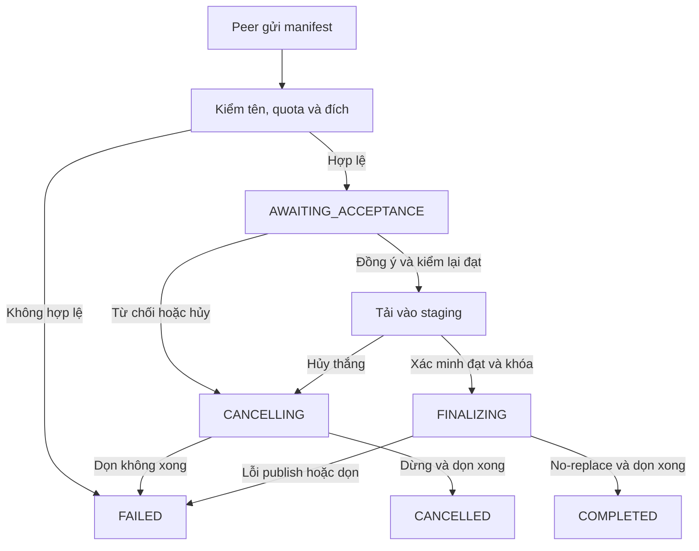

# AD — Kiến trúc CrocCoc

**CC-AD-001 · 0.5 · 2026-11-19 · Dự thảo.** Tham chiếu [ISO/IEC/IEEE 42010:2022](https://www.iso.org/standard/74393.html). Phân biệt [wire init và wire mục tiêu](transfer-contract.md).

| Thành phần | Sở hữu |
| --- | --- |
| FE / FE-IPC | React hiển thị, xác nhận và đồng bộ snapshot. Adapter kiểm payload Wails. Mock không có quyền truyền thật. |
| HOST | Bridge và UI native Windows, clipboard, Explorer, vòng đời WebView, `SingleInstanceLock` với UUID cố định. Lần mở sau chỉ đưa cửa sổ đầu lên, không tiếp nhận tham số truyền. |
| BE | Một coordinator sở hữu state, revision, deadline, preflight, publish và quyết định hủy. Không phụ thuộc Wails. |
| ENGINE | Dùng giao thức Croc. Phải có metadata đầy đủ trước payload, cổng đồng ý và tín hiệu kết quả có cấu trúc. Không được ghi đích cuối hoặc phát snapshot UI trực tiếp. |
| WIN-FS | Kiểm identity/volume, staging, kiểm đường dẫn theo handle, publish no-replace và phục hồi vùng tạm do app sở hữu. |

## ADR-03 — Chọn engine sau spike

Mốc spike nội bộ `SPIKE-ENGINE` tương ứng với CC-02 trong ghi chú lịch sử. Đã đọc mã [Croc v11.6.4](https://github.com/schollz/croc/tree/v11.6.4), không coi kết quả đọc là chạy thử Windows. Module là `github.com/schollz/croc/v11`, giấy phép MIT, `go.mod` yêu cầu Go 1.27.3 cho bản pin này. Package `src/croc` xuất `NewCtx`, `Send` và `Receive`. Điểm vào nhận metadata `processSenderInfo` là nội bộ và prompt đọc stdin. Import trực tiếp không tự cung cấp hook manifest/consent hoặc cô lập I/O.

| Phương án | Đánh giá |
| --- | --- |
| Croc CLI nguyên bản | Dễ đóng gói, cách ly tiến trình. Có `CROC_SECRET`, `--disable-clipboard` và `--no-update-check`. Nhưng prompt nhận chỉ tóm tắt, không có manifest máy đọc trước payload. Không đủ cho nhận MVP nếu chỉ parse prompt. |
| Nhúng thư viện Go trong host | Bỏ kênh secret qua argv/env. `NewCtx` hữu ích cho hủy. Phải chứng minh toolchain, hook nhận, I/O không qua biến toàn tiến trình, biên ghi và khả năng dừng. Không đổi CWD/stdin/stdout toàn host để giả lập API thư viện. |
| Helper Go riêng bọc một nhánh Croc tối thiểu | Ưu tiên làm spike nếu thư viện nguyên bản thiếu hook. Framing typed qua pipe riêng để cấp secret, manifest, quyết định và kết quả. Cách ly CWD/I/O, giữ được giao thức Croc và giới hạn thời gian dừng cả cây tiến trình. Chi phí là duy trì patch, nguồn, giấy phép và kiểm hồi quy mỗi lần bump. |
| Giao thức riêng | Ngoài MVP. Không dùng để lách cổng an toàn. |

Nếu thử CLI, đọc stdout/stderr đồng thời, tách frame theo LF/CR, loại ANSI, giữ kích thước mỗi frame và tổng bộ đệm hữu hạn. Không coi dòng stderr là API ổn định. Không nhặt secret từ URL/lệnh in ra nếu không có fixture pin chứng minh chính xác. Không gửi Enter hoặc `--yes` để bỏ qua chấp nhận. Gặp prompt/định dạng không hỗ trợ thì dừng an toàn. Không suy state, phần trăm hoặc thành công từ progress bar, exit status không thay xác minh dữ liệu. Không lưu output thô. Unmodified CLI có thể hữu ích cho kiểm tương tác, nhưng không được bật nhận thật nếu không có manifest có cấu trúc và chặn payload.

**Cổng spike:** Windows x64, hai đầu, fixture biết trước. Chứng minh phiên bản và tuyến relay, kênh mã không argv, không tự chép/nhớ cấu hình, manifest cấu trúc trước khi yêu cầu payload, chấp nhận/từ chối, ranh giới ghi, thời hạn và cây tiến trình nếu có. Nếu helper cũng không đạt, giữ `NOT_INTEGRATED`, chỉ demo mock và mở lại ADR. Không thu gọn consent hoặc no-replace để kịp lịch.

## Luồng nhận Windows

1. Giữ identity thư mục đích trên ổ NTFS cục bộ cố định, kể cả D:. Không dùng `%TEMP%` để chứa payload. Từ chối UNC/ổ mạng, reparse point trên chuỗi tổ tiên và thư mục không chứng minh được quyền ghi hoặc khả năng publish. Thiết lập quyền vùng tạm giới hạn người dùng chạy app.
2. Nhận manifest bất biến, chưa yêu cầu hoặc ghi payload. Chuẩn hóa tương đối và kiểm từng component theo Windows. Chặn đường tuyệt đối, drive/UNC, `.`, `..`, tên thiết bị Windows (CON, PRN, AUX, NUL, COM1–9, LPT1–9 và biến thể được Windows coi là thiết bị), kể cả có phần mở rộng, dấu chấm/khoảng trắng cuối, dấu hai chấm/ADS, ký tự cấm và điều khiển bidi. Phát hiện alias không phân biệt hoa thường theo đích, alias 8.3 và xung đột tệp/thư mục. MVP từ chối đường dẫn đạt 260 đơn vị UTF-16 tính cả NUL theo chính sách bảo thủ, kiểm cả staging và đích.
3. Preflight root-level trước khi hiển thị đề nghị. Mỗi **mục** là một tệp hoặc thư mục cấp cao nhất được mô tả trong manifest. Không gộp vào thư mục đã có. Từ chối manifest có hơn 10.000 entry (kể cả thư mục), tệp khai vượt mức hoặc tổng payload vượt 20 GiB. Dùng phép cộng có kiểm tràn. Kiểm dung lượng trống theo quota người dùng tối thiểu bằng tổng payload cộng 256 MiB và áp ngân sách khi nhận. Giá trị là giới hạn MVP đề xuất, không phải số đo.
4. Hiện đề nghị đã kiểm, tên không dùng để thao tác trực tiếp từ UI. Chỉ tải sau xác nhận đúng `offerID` và chạy lại preflight. Nếu trùng cho người dùng đổi đích và mở phiên mới, thay vì đổi tên tự động. MVP giữ nguyên tên và cấu trúc đã được xác nhận. Nếu sau này có đổi tên, phải hiện trước và được đồng ý. Nhận từ chối/timeout không ghi payload.
5. Tạo staging độc quyền trực tiếp trong đích với tên ngẫu nhiên `.croccoc-stage-<uuid>`, thư mục payload riêng và marker phiên không chứa secret. Ghi sổ sở hữu riêng tại AppData gồm UUID, volume ID, identity đích/staging, marker nonce và trạng thái. Chỉ cấp phép ghi sau khi lưu được record bền. Dùng handle/check identity để khóa đường dẫn dưới root, tạo mục an toàn, từ chối link, reparse point, alias và metadata không khai báo **trước từng thao tác ghi**. CWD không phải sandbox. Hạn chế payload vào nội dung đã duyệt, dừng khi số byte vượt khai báo/ngân sách hoặc hết đĩa.
6. Khi engine báo xong, kiểm toàn bộ cây staging, tập mục, kích thước và kiểm tra toàn vẹn giao thức. Khóa `FINALIZING` trước thay đổi đích đầu tiên. Publish từng root item bằng rename no-replace cùng volume, ứng viên là [FileRenameInfo qua handle](https://learn.microsoft.com/en-us/windows/win32/api/fileapi/nf-fileapi-setfileinformationbyhandle) với `ReplaceIfExists=FALSE`. Spike phải chứng minh cơ chế neo đích và kiểm identity tại thao tác rename, không dùng riêng việc kiểm path trước đó làm bằng chứng chống đổi tổ tiên. Không copy/delete hoặc fallback cross-volume, không thực hiện check-exists rồi ghi đè. Đích D: hợp lệ nếu staging và các mục thực sự cùng volume D:.
7. Nếu trùng muộn hoặc lỗi giữa chừng, chỉ rollback mục đã công bố khi còn chứng minh được identity và không bị sửa/thay thế, kể cả cây thư mục. Không đụng dữ liệu có sẵn. Nếu không chứng minh được, giữ mục lại, báo có kết quả một phần và hướng dẫn kiểm tra thủ công. Không coi cả lô là nguyên tử. Không báo thành công nếu công bố thiếu hoặc dọn thất bại.
8. Khởi động lại không resume. Sau khi giữ khóa instance, chỉ dọn staging có record do app giữ, marker/volume/identity khớp và không có ownership lease/runner đang sống. Không quét xóa theo prefix, không theo reparse point. Nếu không chứng minh được, đích offline, hoặc nội dung bị thay, báo cần xử lý thủ công và thử lại lần sau khi có điều kiện. Không tự rollback mục đã đưa ra đích sau crash. Khoảng trống crash trước record sở hữu có thể để lại thư mục cần dọn thủ công, không cấp quyền tải trước khi ghi xong record.

Ở phía gửi, kiểm tất cả tổ tiên và mục con để từ chối symlink/junction/reparse point. Dùng handle nguồn ổn định, không cho ghi/đổi tên trong khi đọc nếu hệ tệp hỗ trợ. Nếu engine mở lại theo path mà không chứng minh được identity, dùng bản sao đã kiểm trong staging gửi riêng hoặc không nhận nguồn. Kiểm thư mục thay đổi, lỗi khóa và mất quyền, không báo thành công với nội dung chưa xác nhận.

## Deadline và cạnh tranh

Giá trị mục tiêu MVP là 2 phút chuẩn bị, 5 phút chờ peer tính từ lúc engine sẵn sàng, 2 phút duyệt tính từ khi hiện đề nghị, 2 phút không có tiến triển payload, và tối đa 10 giây dừng/dọn chủ động. Chứng minh bằng Windows hoặc điều chỉnh giá trị qua review trước nghiệm thu. Không gia hạn thời gian chờ peer/duyệt vì event hoặc polling.

Coordinator duy nhất hoặc vùng khóa ngắn quyết định cancel/finalize. Worker engine vận chuyển dữ liệu, worker I/O drain hai pipe đồng thời nếu có, và worker publish/dọn trả kết quả về coordinator. Worker không tự phát terminal. Không chờ I/O trong vùng khóa. Hủy có trạng thái ngay, stop via context/control pipe, chờ có hạn, rồi dừng cưỡng bức nếu cần. Với helper Windows, đánh giá Job Object kill-on-close và gắn tiến trình trước lúc cho nó chạy, fail closed nếu không bảo đảm quản lý cây. Không tuyên bố dọn xong chỉ vì tiến trình cha đã thoát. Nếu kill/wait thất bại, giữ khóa tài nguyên khi còn hoạt động, không publish.
