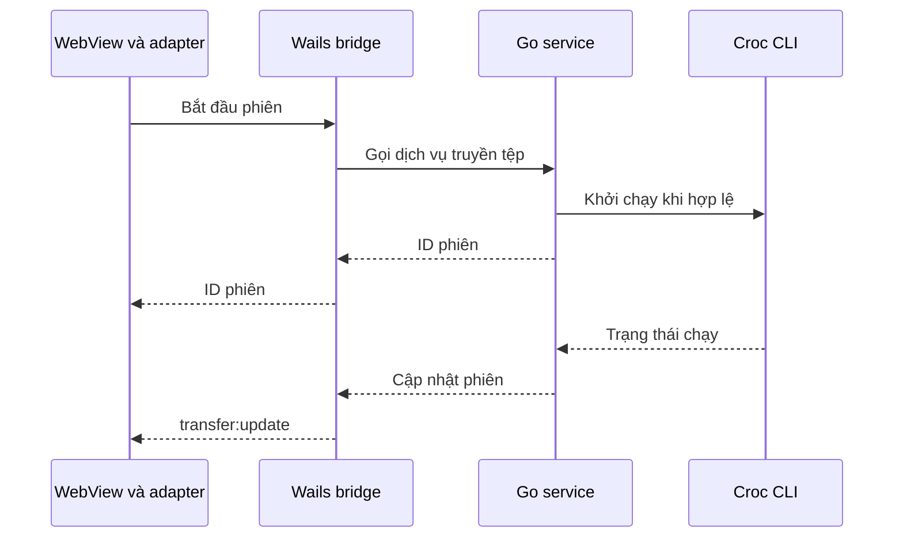

# AD — Mô tả kiến trúc CrocCoc

| Mã | Phiên bản | Ngày | Trạng thái | Mã nguồn đối chiếu |
| --- | --- | --- | --- | --- |
| CC-AD-001 | 0.2 | 2026-11-19 | Dự thảo để duyệt | `610b622` |

Cấu trúc tài liệu tham chiếu [ISO/IEC/IEEE 42010:2022](https://www.iso.org/standard/74393.html). Đối tượng mô tả là ứng dụng desktop CrocCoc. Người dùng chạy một gói desktop, còn frontend và backend tách mã nguồn, trách nhiệm và kiểm thử. Croc CLI, WebView2 và mạng là các phụ thuộc ngoài.

## 1. Bên liên quan, mối quan tâm và góc nhìn

| Góc nhìn | Bên liên quan | Câu hỏi cần trả lời | Mô hình dùng trong tài liệu |
| --- | --- | --- | --- |
| VP-01 Cấu trúc | Frontend, backend, reviewer | Lớp nào sở hữu logic và lớp nào chuyển lời gọi? | Bảng thành phần và hướng phụ thuộc. |
| VP-02 Vận hành | Người gửi, người nhận, backend, QA | Một phiên đi qua các lớp nào, ai xử lý lỗi và hủy? | Luồng theo chế độ, quy tắc trạng thái từ ICD. |
| VP-03 Triển khai | Tích hợp, QA, người dùng desktop | Gói nào chạy trên Windows, cần gì và có gọi mạng không? | Bảng node triển khai và ranh giới tin cậy. |

## 2. VP-01 — Cấu trúc và sở hữu

| ID | Thành phần | Trách nhiệm và phụ thuộc |
| --- | --- | --- |
| FE | [React UI](../frontend/src/App.tsx) | Hiển thị chế độ, trạng thái và thao tác. Dùng `TransferClient` làm biên gọi, không điều phối tiến trình Croc. |
| FE-MOCK | [Mock TypeScript](../frontend/src/mockTransfer.ts) | Lịch event có thể hủy, mã mẫu, không đọc hoặc ghi tệp. Dùng cho trình duyệt và nút mô phỏng trong desktop init. |
| FE-IPC | [Adapter Wails](../frontend/src/adapters/wailsTransfer.ts) | Ánh xạ lời gọi và event sang `TransferClient`. Không quyết định quy tắc hủy hay chuẩn hóa dữ liệu nghiệp vụ. |
| HOST | [Wails host](../main.go) và [bridge](../app.go) | Nhúng bundle frontend, bind `main.App` và chuyển lời gọi vào `transfer.Service`. Không sở hữu tiến trình truyền. |
| BE | [Backend Go](../backend/transfer/) | Sở hữu kiểu dữ liệu và hành vi truyền. Không import Wails. Hiện bind một dịch vụ báo chưa tích hợp. |
| CLI | Croc CLI | Phụ thuộc ngoài do backend mục tiêu khởi chạy và theo dõi. Bản init không chạy binary này. |

Hướng phụ thuộc khi tích hợp là frontend → adapter → Wails bridge → backend. Điều khiển trạng thái phải thuộc backend. Wails chuyển tiếp event, còn UI trình bày trạng thái. Frontend có thể thay implementation `TransferClient` bằng mock mà không cần Go.

## 3. VP-02 — Luồng chạy và trạng thái

| Chế độ | Đường đi | Kết quả xác định |
| --- | --- | --- |
| Trình duyệt init | FE → FE-MOCK → FE | Gửi, nhận và hủy bằng lịch mẫu. Không dùng mạng để truyền tệp. |
| Desktop init, kiểm tra Croc | FE → FE-IPC → HOST → BE | Hiển thị trạng thái chưa tích hợp. Bấm nút mô phỏng vẫn dùng FE-MOCK. |
| Desktop mục tiêu | FE → FE-IPC → HOST → BE → CLI | Backend kiểm tra đầu vào và khả dụng, nhận hoặc từ chối phiên, theo dõi Croc. Event đi ngược qua HOST và FE-IPC. |

Sơ đồ minh họa đường thành công **mục tiêu**. Thứ tự event đầu tiên so với Promise chưa được xác nhận. Quy tắc ID, vòng đời và cửa sổ hủy nằm trong [ICD](transfer-contract.md), không suy ra từ thứ tự minh họa. Khi hủy hoặc thoát, backend mục tiêu chịu trách nhiệm đóng tài nguyên runner. Khi thất bại, không trả lỗi thô của tiến trình lên UI.

## 4. VP-03 — Triển khai và dữ liệu

| Node | Tài nguyên | Ranh giới |
| --- | --- | --- |
| Máy phát triển | Node/Vite, Go, Wails CLI | Có thể chạy riêng mô phỏng frontend. Build Windows cần bundle trước khi Go nhúng tài nguyên. |
| Máy người dùng | EXE Wails x64 và WebView2 | Giao diện và dịch vụ Go nằm trong cùng ứng dụng desktop, không cần dịch vụ HTTP backend riêng. |
| Tiến trình con mục tiêu | Binary Croc đã khóa | Backend khởi chạy không qua shell. Croc xử lý kết nối tới peer hoặc relay. Chưa có ở init. |
| Mạng | Peer và relay nếu cần | Ngoài phạm vi điều khiển của UI. Không có dịch vụ relay tự quản trong phạm vi bản đầu. |

Đường dẫn, thư mục đích và mã kết nối là dữ liệu cục bộ nhạy cảm. Chỉ chuyển trường cần thiết qua IPC và runner. Không đưa mã vào log, lịch sử hay gói bằng chứng. Thư mục đích có quyền ghi và hành vi khi trùng tệp cần kiểm thử trước khi phân phối.

## 5. Quyết định và đối chiếu giữa các góc nhìn

| Mã | Quyết định | Lý do và hệ quả |
| --- | --- | --- |
| ADR-01 | Giữ Wails IPC thay cho HTTP backend riêng. | Một ứng dụng cục bộ đơn giản hơn, nhưng cần WebView2 và kiểm thử binding native. |
| ADR-02 | Giữ `main.App` là bridge và tiêm `transfer.Service`. | Có thể test đơn vị backend không cần Wails. Contract vẫn phải đồng bộ hai ngôn ngữ. |
| ADR-03 | Tích hợp Croc CLI thay vì viết giao thức riêng. | Tận dụng CLI, đổi lại phải khóa phiên bản, quản lý tiến trình và xác minh trên Windows. |

VP-01 định nghĩa ranh giới FE-IPC/HOST mà VP-02 sử dụng. Mapping được ghi trong [đặc tả API](transfer-contract.md) và kiểm ở CC-T-02. VP-03 giải thích cách HOST đóng gói bundle FE, được kiểm ở CC-T-03 và CC-T-16. CLI chỉ xuất hiện như phụ thuộc mục tiêu ở VP-01, VP-02 và VP-03. Không dùng ba góc nhìn đó để khẳng định Croc đã cài hoặc truyền thành công.

Rủi ro còn mở gồm cuộc đua giữa hủy và hoàn tất, đọc thiếu tiến độ từ Croc, dọn tiến trình con và khác biệt WebView2 giữa các máy. [Kế hoạch xác minh](verification.md) ghi các ca hồi quy và [thủ tục phát hành](release.md) ghi bằng chứng cần có trước bàn giao.
