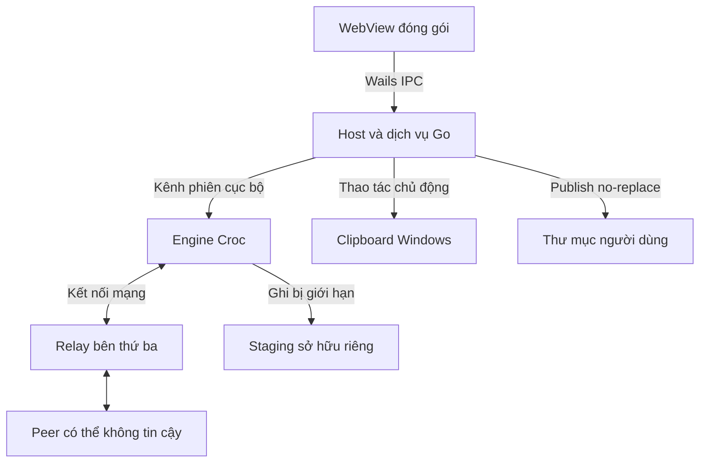

# TM — Mô hình đe dọa

**CC-TM-001 · 0.5 · 2026-11-19 · Dự thảo.**

Tài sản gồm mã phiên, nội dung và tên tệp, đường dẫn máy, quyền ghi đích và tài nguyên máy. Frontend được đóng gói, không tải nội dung từ xa và không xuất payload sự kiện sang logger. Không coi một mã hợp lệ là định danh người gửi hoặc người nhận.

## Mã và clipboard

| Kênh | Chính sách |
| --- | --- |
| Wails IPC | Ngoại lệ duy nhất trên app wire là đối số `code` của CC-API-03 và `connectionCode` trong event/snapshot gửi đang chờ theo ICD. Không đưa vào response của CC-API-08, error, event khác hoặc chẩn đoán. Snapshot chẩn đoán được dựng riêng bằng allowlist. |
| Tiến trình con | Ưu tiên pipe riêng với framing và handle kế thừa giới hạn. Worker helper nhận mật khẩu relay và mã phiên qua stdin JSON giới hạn kích thước, không qua argv. `CROCCOC_RELAY_PASSWORD` khi nạp từ biến môi trường host được `os.Unsetenv` ngay lúc khởi tạo; không chạy qua shell, không kế thừa config cá nhân, không remember/debug. Worker được gắn Windows Job Object `KILL_ON_JOB_CLOSE`. |
| Clipboard | Chỉ thao tác do người dùng yêu cầu qua `CopySendCode(transferID)`. Host Win32 tạo message-only HWND riêng, chuẩn bị bộ nhớ trước khi mở clipboard (có thử lại ngắn khi bận), đặt đủ marker `ExcludeClipboardContentFromMonitorProcessing`, `CanIncludeInClipboardHistory`, `CanUploadToCloudClipboard` trước `CF_UNICODETEXT` trong cùng lần mở. Nếu bất kỳ bước nào thất bại thì trả `COPY_UNSAFE` và không đặt mã. Lưu ý giới hạn Win32: nếu lỗi xảy ra sau `EmptyClipboard`, clipboard trước đó có thể bị trống thay vì khôi phục nội dung cũ. Không dùng `ClipboardSetText`, Clipboard API WebView hay fallback thường trên desktop. |
| Kênh bền | Cấm mã trong argv, log, telemetry, cấu hình, ảnh, dump, gói kiểm thử và báo cáo lỗi. Không lưu output thô dù từ pipe riêng. |

Cấm argv để giảm rò ngẫu nhiên qua lịch sử shell, liệt kê lệnh, công cụ giám sát và log thu thập cmdline. Điều này không biến env thành kho bí mật. Tiến trình cùng người dùng có quyền đọc bộ nhớ tiến trình, administrator, debugger, mã độc, clipboard manager bên thứ ba hoặc WebView đã bị xâm nhập nằm ngoài bảo đảm giữ kín mã. Marker Windows loại Win+V và cloud sync, không che nội dung clipboard đang hoạt động. Sao chép thủ công ngoài nút của app không được bảo đảm marker. Xem [định dạng clipboard Microsoft](https://learn.microsoft.com/en-us/windows/win32/dataxchg/clipboard-formats#cloud-clipboard-and-clipboard-history-formats).

## Relay, Windows Firewall và rủi ro

MVP chỉ dùng tuyến relay công cộng được spike xác minh. Trước khi kết nối, thông báo rằng dữ liệu truyền qua relay bên thứ ba, relay quan sát được metadata mạng, thời điểm và lưu lượng. Nội dung được bảo vệ theo giao thức Croc, không tuyên bố relay hoặc peer là đáng tin. Nếu không chấp nhận, người dùng có thể không mở phiên. Tắt public relay hoặc chọn relay riêng là hạng mục sau MVP. Không tự fallback sang LAN, DERP hoặc relay khác ngoài chính sách đã công bố cho MVP. Kỹ thuật cấu hình route của cả hai vai trò phải qua kiểm trên binary/engine thật.

Từ mã nguồn [CLI](https://github.com/schollz/croc/blob/v11.6.4/src/cli/cli.go) và [local relay](https://github.com/schollz/croc/blob/v11.6.4/src/croc/local_relay.go), bản 11.6.4 phía gửi mặc định lấy năm TCP listener từ 9009, thường là 9009–9013, nhưng có thể bỏ qua cổng bận. `send --no-local` tắt local relay ở phía gửi, không phải bằng chứng đã tắt các tuyến ngoài chính sách ở cả hai vai trò. Nếu thêm LAN sau MVP, thử cửa sổ Defender Firewall lần đầu và khi từ chối trên Windows sạch. Không yêu cầu tắt firewall. Chưa chạy thử hộp thoại firewall.

| Rủi ro | Kiểm soát và phần còn lại |
| --- | --- |
| Người đoán hoặc biết mã chiếm phiên | Mã ngẫu nhiên từ engine đã duyệt, chỉ phiên ngắn, không tái sử dụng và khuyên xác minh qua kênh khác. Người có mã vẫn có thể giả làm peer. |
| Relay bên thứ ba theo dõi, chặn hoặc gián đoạn | Công bố tuyến, không dùng relay như dịch vụ nhận dạng. QA xác minh tuyến và lỗi kết nối. Không hứa ẩn metadata hoặc luôn khả dụng. |
| Người gửi độc hại điều khiển manifest, tên và dữ liệu | Kiểm đường dẫn và quota trước tải, đồng ý rõ ràng, staging an toàn và no-replace. Không tự mở tệp. Nội dung hợp lệ về định dạng vẫn có thể độc hại. |
| Đường dẫn đổi giữa kiểm và ghi | Identity/handle, no-replace tại publish và tái kiểm. Không xóa mục không xác minh sở hữu. |
| Hủy, treo hoặc crash giữ phiên và chiếm đĩa | Deadline, dừng có hạn, sổ sở hữu staging và dọn an toàn sau crash. Mục đã công bố không tự xóa khi khởi động lại. |
| Supply chain Croc/WebView2 | Ghim phiên bản đã duyệt, xác minh danh tính, cập nhật sau thử hồi quy. Xem [CMP](configuration-management.md). |
